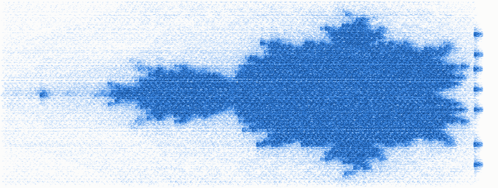
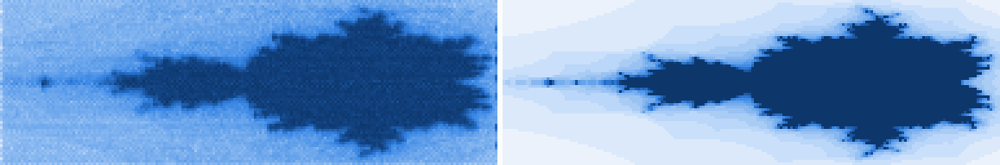

# Serum 2 Mandelbrot computer

A Serum 2 patch that computes the Mandelbrot set inside its own modulation matrix and draws
it in the spectrogram of its output. Every MIDI note is one pixel. The note's voice iterates
z ← z² + c with LFOs and mod slots, times how long the orbit takes to escape, then plays a
short tone at the pixel's row frequency, at a level set by that escape time.



*Linear spectrogram, 300–6800 Hz, of the preset playing the MIDI file: 64 rows × 96 columns,
6,144 pixel notes in 13.9 s.*



*Left: the same audio sampled on the image grid. Right: the true escape-time image.
Score 1 − correlation = 0.021, where 0 is a perfect match.*

## Play it

1. Load [`mandelbrot_v3.SerumPreset`](mandelbrot_v3.SerumPreset) in Serum 2.
2. Import [`mandelbrot_v3.mid`](mandelbrot_v3.mid) onto that track and set the project to
   **150 BPM**. The patch's timing is in seconds, so the tempo has to match the file.
   Don't quantize the notes or change their velocities: velocity carries the x coordinate.
3. Bounce it, offline if real-time playback stutters. Bounce to 32-bit float, or turn the
   master down about 4 dB: the output peaks near +3 dBFS.
4. View the bounce as a spectrogram:
   - **linear** frequency axis, about 300–6800 Hz (the rows sit every 100 Hz from 400 to 6700 Hz);
   - FFT size 2048–4096, Hann window;
   - about 40 dB of range.

   Sonic Visualiser, iZotope RX and Audacity's spectrogram view (set to linear) all work.

The file starts with one quiet warm-up note, and the image begins 0.8 s in.

Played in FL Studio with Serum 2. Also checked by loading this preset file and playing this
MIDI file through Serum 2.1.5 (VST3) in a headless host: score 0.021 at both 48 kHz and 44.1 kHz.

## What is computed and what is rendered

**Computed honestly, in Serum:** the iteration z ← z² + c and the escape time of every pixel.
The arithmetic is Serum's own modulation, and nothing is precomputed. The MIDI file only
carries c: velocity → cx ∈ [−2, 0.5], note → cy ∈ [−1.2, 1.2].

**Rendering, free to fudge:** everything that turns an escape time into a picture. That
means the shading curve, the pixel layout, the convolution IR and the chirp. These were
tuned with CMA-ES, scoring each candidate with a full Serum render against the reference
image.

## How it works

### The computer: `serum_mandel/core.py`

- **Numbers.** A value v ∈ [−2, 2] is stored as u = (v + 2)/4 in the phase of an LFO with
  rate 0 and a saw shape, so the LFO outputs its phase. Everything routed to an LFO's phase
  is summed and then clamped to [0, 1], which gives addition for free.
- **Squares.** A mod slot multiplies its source by its aux source exactly. With a V-shaped
  curve on both, it outputs x²/4. Fx = x²/4 − y²/4 + (cx + 2)/4. Fy is
  (x + y)²/4 − x²/4 − y²/4 + (cy + 2)/4, which is xy/2 plus the offset.
- **Registers.** Slot smoothing works as a track-and-hold. With smoothing 0 the slot
  tracks; smoothing modulated up to 100 makes it hold. A shadow pair S ← F and a master
  pair R ← S, clocked on alternate halves of a 500 Hz clock, step the orbit once per tick.
  That is 20 iterations in 40 ms.
- **The clock is global.** In Serum 2, modulating a mod slot's own parameter (here its
  smoothing) is not per voice: one voice's value applies to all of them. So one
  free-running mono LFO clocks every voice, and each register cuts its hold window from it
  with a slot curve.
- **Reset.** Slot smoothing state survives note-on, so a reused voice would inherit the
  last pixel's z. For the first 10 ms of each note an envelope pulls the registers to the
  clamp point, and the register LFO shape reads that point as z = 0.
- **Escape.** When an orbit leaves the box |x|, |y| < 2, its F node clamps and reads 0.
  A per-voice LFO integrator latches that event. An escape timer (another LFO, counting
  time from note-on) stops when the latch fires, so its phase ends up holding the escape
  time. An LFO at rate 0 holds its phase exactly.

In total the computer is 10 LFOs and 34 mod slots, and the display adds 3 more slots. Each
voice runs its own copy, and up to 32 voices run at once.

### The display: `serum_mandel/render.py`

- **Pixels.** Each note is 62 ms long: a 12 ms reset, 40 ms of compute, then a 10 ms burst of
  Osc C (a sine). A Note → coarse-pitch curve sets the burst's frequency to its row's.
  Its level is a shading curve of the escape time.
- **Tilted grid.** Serum sounds at most 32 voices. Row r's pixel in column c starts at
  c·P + ((27r mod 64)/64)·P, with P = 64 × 68 ms / 32 = 136 ms. That staggers the notes so no
  more than 32 overlap, and keeps neighbouring rows from sounding together.
- **One linear response.** Serum's Convolve FX holds a generated IR: a comb with taps every
  10 ms (1/row spacing, so its teeth land on the rows), jittered for diffusion, with a
  decaying envelope, 1.5 column periods long. It stretches every 10 ms burst across its
  grid cell. A 14 Hz chirp per burst tilts each stroke a little.

### Known artifacts

- The jitter leaves some speckle in the shaded exterior.
- The last column's tails make a few dots past the right edge.
- Osc A and B carry a DC ramp wavetable at volume 0. They're leftovers of the measurement
  harness, kept so the preset is exactly the one that was verified.

## Rebuild and check

This needs Python 3.10 or later and `pip install -r requirements.txt` (numpy and zstandard).

```bash
python build.py
```

This writes `build/mandelbrot_v3.SerumPreset` and `build/mandelbrot_v3.mid`, byte-identical
to the ones in the repo root, plus `build/reference.png`. With `--look other.json` it builds
another rendering look; the fields are `render.Look`'s, and [`look.json`](look.json) is the
tuned one.

```bash
python score.py bounce.wav
```

This scores your own bounce: it prints 1 − correlation with the reference and writes
`bounce_vs_ref.png` and `bounce_spectrogram.png`. It assumes the bounce starts where the MIDI
file starts; use `--lead` if yours has a different offset. It reads 16/24/32-bit PCM and
float WAVs.

| Path | What |
|---|---|
| `mandelbrot_v3.SerumPreset`, `mandelbrot_v3.mid` | The result |
| `look.json` | Tuned rendering parameters |
| `serum_mandel/core.py` | The iteration and escape timer (the honest part) |
| `serum_mandel/render.py` | Pixel layout, display voice, IR, schedule, reference image and score |
| `serum_mandel/prims.py` | Patch building blocks: nodes, slot curves, track&hold |
| `serum_mandel/patch.py` | Builds a Serum 2 patch in code from the init state |
| `serum_mandel/preset.py`, `xferjson.py`, `cbor.py`, `templates/` | `.SerumPreset` container: XferJson header + zstd + CBOR; init state captured from Serum 2 |
| `serum_mandel/midi.py`, `image.py` | MIDI writer; PNG, WAV and spectrogram helpers |
| `build.py`, `score.py` | Build the files; score a bounce |

## License

MIT, see [LICENSE](LICENSE). Serum is made by Xfer Records and is not included here.
